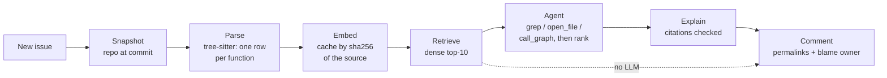

# PinPoint

A GitHub bot that reads a new issue and points to the functions most likely responsible.

## The problem

A bug report describes a symptom ("`pytest.raises` prints the wrong message"); the fix lives in one or two
functions somewhere in the codebase. In the repos this was measured on, that means finding a couple of
functions among a median of **13,400 functions in 940 files** per snapshot (Django ~25,000, SymPy ~37,000,
up to 42,560). Most of the time goes to *finding* the code, not fixing it.

PinPoint does the finding. When an issue is opened, it comments with:

- the suspect functions, as permalinks to the exact lines at the commit it looked at,
- who wrote most of those lines (`git blame`, named, never @-pinged),
- with an LLM configured: a short "Why" whose `path:line` citations are checked against the code it was shown.

## Results

Benchmarked on [SWE-bench Lite](https://www.swebench.com/): 300 real bugs from 12 open-source Python repos,
each with the gold patch that fixed it. The gold "answer" is the function(s) the patch changed. The split was
locked before any tuning: **200 tune** issues (used to pick strategies) and **100 held-out** issues, scored
once at the end. The table is the held-out score.

| Ranking | Function acc@1 | Function acc@5 | Function MRR | File acc@5 | File MRR |
|---|---|---|---|---|---|
| BM25 (keyword search) over function source | .156 | .311 | .226 | .580 | .428 |
| Embeddings, one chunk per function (bge-large) | .211 | .422 | .292 | .660 | .529 |
| Hybrid: reciprocal rank fusion of BM25 + embeddings | .200 | .411 | .298 | – | – |
| Embeddings + call-graph expansion | .122 | .244 | .194 | .620 | .459 |
| **Agent: embedding seeds + tools (Llama 3.3 70B)** | **.489** | **.611** | **.546** | **.860** | **.772** |

100 held-out issues, 12 repos; function rows use the 90 that change at least one function. acc@k = the gold is
in the top k; MRR = mean of 1/rank of the first gold hit.

- **The agent roughly doubles the embedding baseline**: it ranks the buggy function first in 49% of held-out bugs
  vs 21%, and the buggy file in the top 5 in 86%. Paired bootstrap on the same issues: function MRR +.254,
  95% CI [+.176, +.335].
- **Hybrid search didn't help** here (+.006 MRR, CI straddles zero), and a name-only call graph *hurt*:
  expanding to callers/callees floods the top 10 and pushes correct hits down.
- **Held-out vs tune**: embeddings held steady (function MRR .292 vs .295 on tune). The agent dropped from .614 on
  the 52-issue slice its fixes were chosen on to .546 here: part of the tune number was fit to that slice.
- **Cost**: the agent averages 6.5 tool calls, 8.5 s, ~27k prompt tokens per issue (~$0.11 at Databricks list
  prices; free within Databricks Free Edition limits).

Every number above has a 95% bootstrap interval in [`NOTES.md`](NOTES.md), along with all the strategies tried
on the way (fixed-size chunks, query rewriting, cross-encoder reranking, prompt variants) and why they lost.

## How it works



1. **Snapshot.** The repo at the issue's commit. In the bot, that's the Actions checkout itself.
2. **Parse.** [tree-sitter](https://tree-sitter.github.io/) turns each source file into one row per function:
   path, qualified name (`Class.method`), line range, source, and the names it calls. Tests and docs are skipped.
3. **Embed.** Each function body becomes a vector. The cache key is the sha256 of the source, so a function that
   hasn't changed is never embedded twice (65% of bodies are shared across snapshots of the same repo).
4. **Retrieve.** The issue text is embedded as a query; the nearest functions by cosine similarity are the
   dense top-10.
5. **Agent.** An LLM gets the issue and the top-10 as seeds, plus three read-only tools sandboxed to the checkout:
   `grep`, `open_file` (lines labelled with their enclosing function), and `call_graph`. It explores for a few
   steps and is then forced to submit a ranking. If the LLM is down, the dense ranking is used, with a warning.
6. **Explain + blame.** A short explanation citing `path:line`; citations that don't match the code are left
   unlinked. The owner is whoever wrote most of the top suspect's lines (`git blame -w`, bots skipped).

One core (`live.report`) behind three front-ends: the Actions bot, a FastAPI `/triage` endpoint, and a Streamlit
"paste an issue" page.

**The benchmark side** runs as a [Databricks](https://www.databricks.com/) job (Asset Bundle in
[`databricks.yml`](databricks.yml)): ingest SWE-bench into Delta tables, parse every issue's snapshot, embed new
function bodies (bge-large endpoint), score every strategy, and sync a Vector Search index. Runs are tracked in
MLflow; [`report.py`](src/pinpoint/report.py) builds the table above with bootstrap intervals.

## Install on your repo

Copy [`bot/pinpoint.yml`](bot/pinpoint.yml) to `.github/workflows/pinpoint.yml`. As shipped it needs **no
secrets** (it runs on the job's own `GITHUB_TOKEN`). The first run embeds every function (a few minutes on a
mid-size repo); later runs reuse the Actions cache and only embed changed code.

Pick how much ranking you want in the Triage step's `env`:

| Setup | Needs | What you get |
|---|---|---|
| `PINPOINT_LLM: none` (default) | nothing | embedding ranking only, no explanation |
| `PINPOINT_LLM: openai` + `PINPOINT_LLM_URL`, `PINPOINT_LLM_MODEL`, secret `PINPOINT_LLM_KEY` | any OpenAI-compatible chat API with tool calling | agent ranking + explanation |
| Databricks: `DATABRICKS_HOST`, `DATABRICKS_TOKEN` secrets, no `PINPOINT_LLM` | a Databricks workspace | agent on Llama 3.3 70B: the setup the numbers above were measured on |

Rate the comment with 👍 / 👎. [`bot/pinpoint-feedback.yml`](bot/pinpoint-feedback.yml) collects the reactions
weekly into a CSV (approval rate reported next to coverage, since votes are sparse and self-selected).

Security: the workflow never interpolates issue text into shell commands (it reads the event file), runs one
job at a time, skips bot authors, and has `contents: read, issues: write` only. The agent's tools are read-only
and the workflow, not the model, posts the comment; `@mentions` and `#refs` in model text are defanged.

## Run it locally

```bash
uv sync
uv run python -m pinpoint.live pytest-dev/pytest --issue 12345      # any public repo + issue
uv run streamlit run src/pinpoint/app.py                            # paste an issue in a page
uv run uvicorn pinpoint.api:app                                     # POST /triage
uv run pytest
```

The same `PINPOINT_EMBEDDER=local` and `PINPOINT_LLM=...` switches work everywhere.

## Limitations

- **The good numbers need an LLM.** The zero-secret default is embeddings only, and with bge-small on the runner
  (weaker than the measured bge-large). Other LLMs behind `PINPOINT_LLM=openai` are unmeasured.
- **Symptom vs. cause.** The most common miss: the agent finds where the error *shows up* (the raising function,
  the printer) rather than the function that computes the wrong value upstream.
- **Name-only call graph.** Calls are matched by name, not resolved by type, so `obj.save()` points at every
  `save` in the repo. That's why expansion hurt as a re-ranker; it's only used as an agent tool.
- **Python only**, one language grammar. Issues whose fix is outside any function (module constants, imports)
  are scored at file level only.
- **Cold start.** The first run on a large repo embeds tens of thousands of functions: minutes on a CPU runner.
- **Benchmark ≠ your repo.** SWE-bench Lite is 12 well-known Python projects, and Llama may have seen their
  history in training. 100 held-out issues gives intervals of about ±.1 on MRR.
